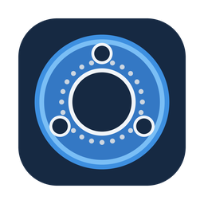
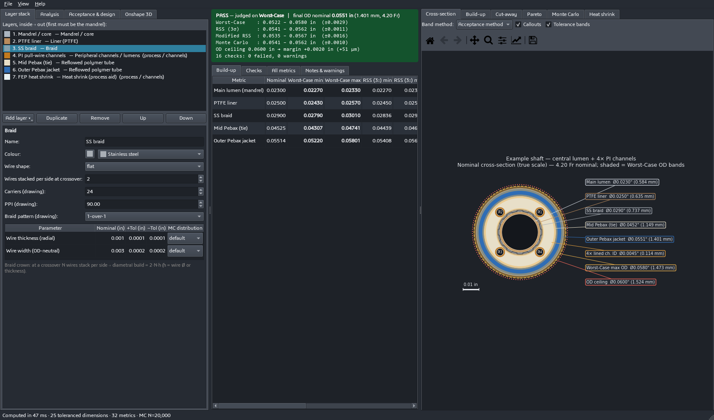
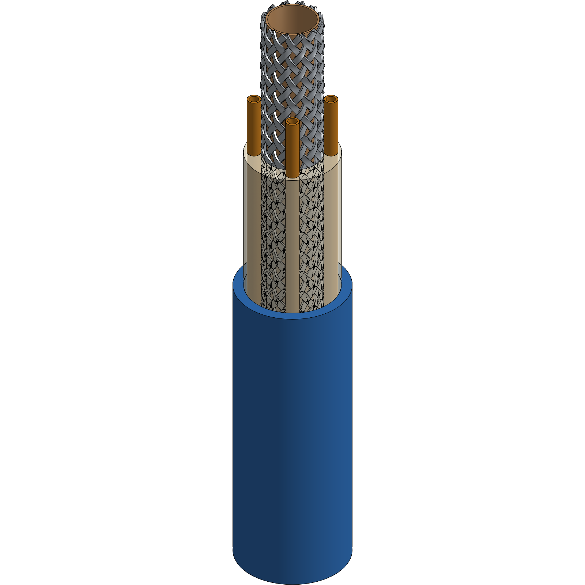
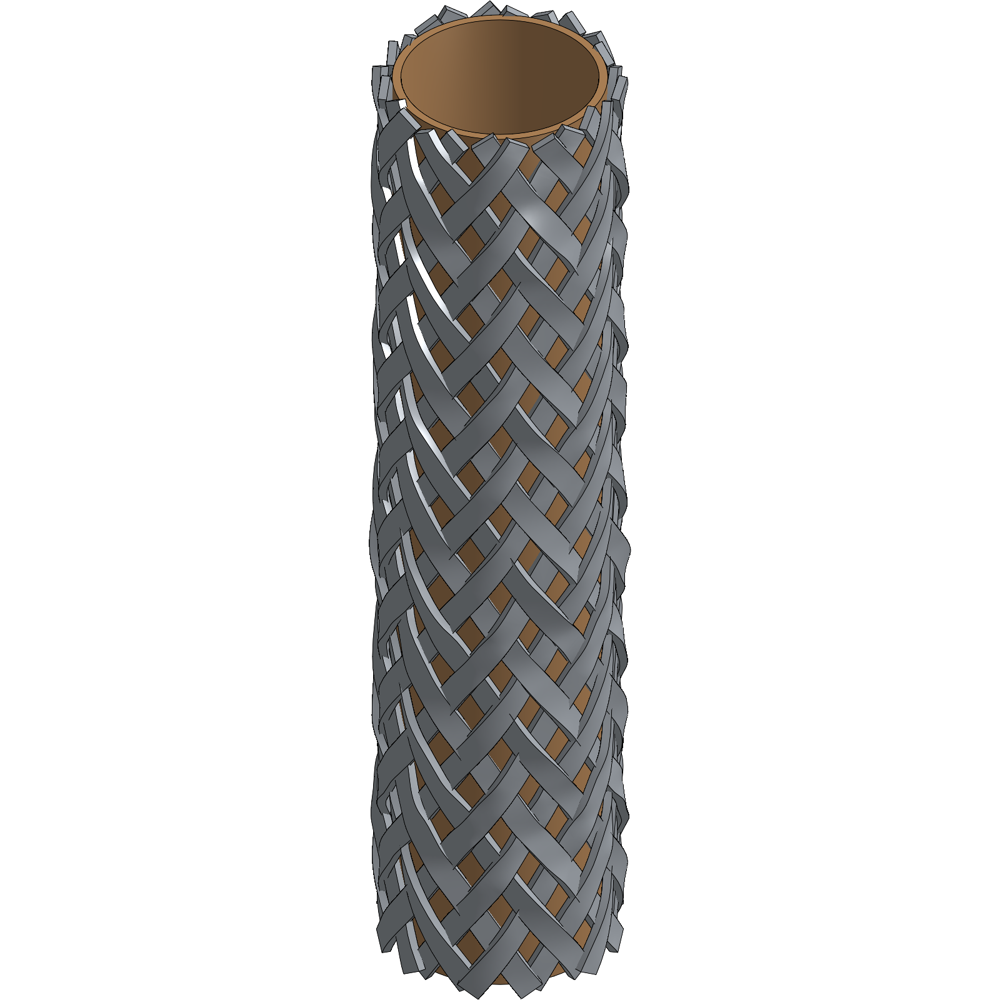

  

<h1 align="center">CathStack</h1>

  <b>Radial tolerance stack-up for layered, multi-lumen catheter shafts,
  with one-click parametric 3D models in Onshape.</b> 
  Free for personal and commercial use · Windows and macOS

  <a href="https://github.com/SinaDreamer/cathstack/releases/latest"><b>⬇ Download the latest version</b></a>

## What it does

* **Build the shaft layer by layer:** mandrel, liners, tie layers, braids
  (round/flat wire), coils, reflowed and slip-fit tubes, peripheral
  channels/lumens (any number, symmetric or not), coatings and heat shrink.
* **Stack it up four ways:** Worst-Case (exact corner evaluation), RSS,
  Modified RSS and Monte Carlo (Latin-hypercube; normal, uniform or
  triangular). Includes sensitivities, a contribution Pareto, and Cp/Cpk with
  predicted yield.
* **Check the design:** OD ceiling, main-lumen minimum, channel webs, wall
  to OD, tube loading clearances and the heat-shrink process window.
* **See it:** true-scale cross-section with tolerance bands, radial
  build-up, longitudinal cut-away and Monte Carlo histograms, in inches
  or mm.
* **Report it:** PDF report and CSV results.
* **Model it in 3D:** generate the design as an editable parametric model in
  your own Onshape account, with real interlaced braid wires, coils,
  channels, material colours and a cut-back view.

  
  

## Download and install

Get the installer for your computer from the
[**latest release**](https://github.com/SinaDreamer/cathstack/releases/latest):

| Your computer | Download |
|---|---|
| Windows 10 / 11 (64-bit) | `CathStack-<version>-Windows-Setup.exe` |
| Mac with Apple Silicon (M1, M2, M3, M4) | `CathStack-<version>-macOS-AppleSilicon.dmg` |
| Mac with an Intel processor | `CathStack-<version>-macOS-Intel.dmg` |

*Not sure which Mac you have? Apple menu  → About This Mac → "Chip"
(Apple M…) or "Processor" (Intel).*

**Windows:** run the setup and follow the steps (no administrator rights
needed). If Windows shows *"Windows protected your PC"*, click
**More info → Run anyway**. This appears because the app is new and not yet
code-signed.

**macOS:** open the `.dmg` and drag **CathStack** into **Applications**. The
first time, if macOS says the app *"cannot be verified"* or *"cannot be
opened"*, go to **System Settings → Privacy & Security**, scroll down and
click **Open Anyway**. You only need to do this once.

**Updating:** install the new version over the old one. Your settings and
saved Onshape keys are kept.

## Onshape 3D models

To generate 3D models you need a free or paid Onshape account and an API key
pair. See the **[step-by-step Onshape guide](docs/ONSHAPE_SETUP.md)**
(about five minutes).

## Important

CathStack is an engineering calculation aid. It is **not a medical device**
and is **not validated** for any specific use. Verify every result
independently, and validate the software for your intended use where your
quality system requires it (e.g. 21 CFR 820 / ISO 13485 §4.1.6).

## License

CathStack is **free to download and use**, for personal and commercial
purposes, under the [CathStack License](LICENSE.txt). It is proprietary
software: copying, modifying, reverse-engineering, reselling or
redistributing it is not permitted. Please share the link to this page
instead. Third-party open-source components are listed in the app under
*Help → Third-party notices*.

Copyright © 2026 Sina Keshavarz. All rights reserved.

## Feedback

Found a bug or have a feature request? Please
[open an issue](https://github.com/SinaDreamer/cathstack/issues).
