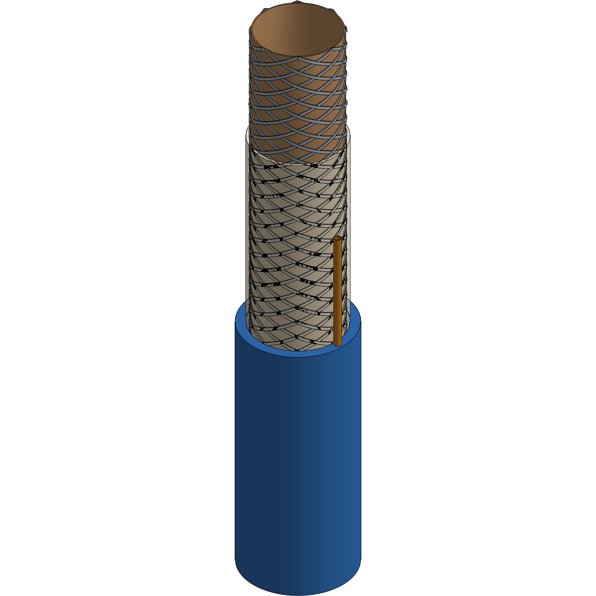
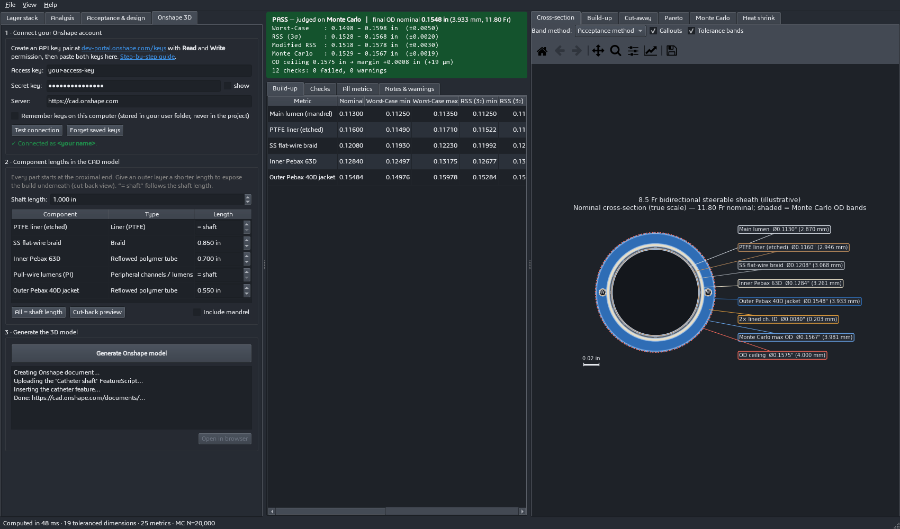

# Connecting CathStack to Onshape

CathStack can draw any design as a **parametric 3D model in your own Onshape
account**: layers as named, coloured parts, the braid as real interlaced
wires, coils at their pitch, channels with their liner tubes, and every
component at the length you choose. This guide takes about five minutes.

---

## 1. What you need

* A free or paid **Onshape account** (<https://www.onshape.com>).
* CathStack installed ([download](https://github.com/SinaDreamer/cathstack/releases/latest)).

## 2. Create your API keys (once)

1. Sign in at **<https://dev-portal.onshape.com/keys>** with your Onshape
   account.
2. Click **Create new API key**.
3. Tick the **Read** and **Write** permissions (*OAuth2Read* /
   *OAuth2Write*). Write is needed because CathStack creates a document.
4. Click **Create**. You get an **Access key** and a **Secret key**.
   **Copy the secret key now — Onshape shows it only once.**

> Enterprise accounts sign in to `https://<company>.onshape.com`; use that
> address as the *Server* below.

## 3. Generate a model

1. Start CathStack.
2. Open or build a design, then open the **Onshape 3D** tab (left panel), or
   use *File → Send to Onshape…*.

   

3. **Connect your Onshape account** — paste the *Access key* and *Secret
   key*. Leave *Server* as `https://cad.onshape.com` unless you use an
   Enterprise address. Tick **Remember keys on this computer** if you don't
   want to paste them again, then press **Test connection**. You should see
   *✓ Connected as &lt;your name&gt;*.
4. **Component lengths** — set the *Shaft length*, and optionally a
   different length per component. All parts start at the proximal end, so
   a shorter outer layer exposes the build underneath (a cut-back view).
   *Cut-back preview* fills in a staggered set for you; *All = shaft length*
   resets it. Lengths are saved with the design file.
5. **Generate the 3D model** — press **Generate Onshape model**. The log
   shows each step; when it finishes the new document opens in your browser.
   A braided shaft takes roughly 25 s per inch to regenerate.

Each press creates a **new document** named `Catheter – <design name>` —
nothing existing is modified.

## 4. What gets created

| In Onshape | Comes from |
|---|---|
| Part Studio with one **Catheter shaft** feature | the design (nominal values) |
| One annular part per solid layer (liner, tie, tubes, coating) | layer ID/OD from the stack-up engine |
| Braid: C/2 S-hand + C/2 Z-hand swept wires, 1-over-1 or 2-over-2 | carriers, PPI (lead = C / (2·PPI)), wire size, pattern |
| Coil: one helical wire per coil layer, alternating hand | wire size, pitch, coil layers |
| Channel holes + a liner-tube part for each lined channel | channel radius, angle, ID, wall |
| Part colours (with opacity for translucent materials) | each layer's *Colour* setting |
| Part lengths | the *Component lengths* table |

The FeatureScript is stored **inside** the new document (tab *Catheter shaft
FeatureScript*), so the document is self-contained and can be shared. Double
click the feature to edit any value — layers, channels, wire settings,
colours or lengths — and the model rebuilds in Onshape.

Heat shrink (a process aid) is not drawn; the mandrel is optional.

## 5. Keeping your keys safe

* Keys typed into the app are only saved if you tick *Remember keys*. They
  go to `~/.cathstack/onshape.env` in **your user folder** (on Windows
  `C:\Users\<you>\.cathstack`) and are sent only to Onshape.
* Never paste keys into issues, e-mails or screenshots.
* *Forget saved keys* deletes the stored file. If a key may have leaked,
  revoke it at <https://dev-portal.onshape.com/keys> and create a new pair.

## 6. Troubleshooting

| Message | What to do |
|---|---|
| `HTTP 401` / `HTTP 403` | Wrong or revoked keys, missing *Write* permission, or the wrong *Server* (Enterprise accounts need `https://<company>.onshape.com`). |
| `Onshape API keys not found` | Paste the keys in the *Onshape 3D* tab. |
| `The FeatureScript did not compile` | Open the linked document's *Catheter shaft FeatureScript* tab to see the error, and please [open an issue](https://github.com/SinaDreamer/cathstack/issues) with it. |
| `feature failed to regenerate` | Open the document and hover the red feature for the reason — usually an impossible geometry (e.g. coil pitch smaller than the wire, wire thicker than the layer build). |
| `Cannot reach …` / timeouts | Check your internet connection or proxy. Long braided shafts can take a few minutes; try a shorter shaft length first. |
